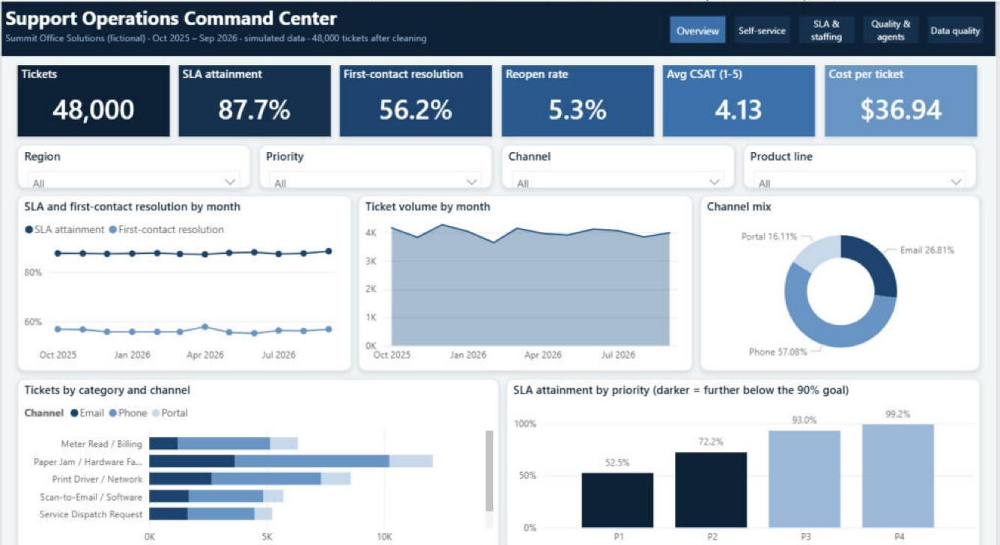

# Support Operations Analytics & Process Improvement

**Power BI · Python (pandas, NumPy) · SQL · Jupyter · Excel (PivotTables)**

An end-to-end business-analyst project for the support center of an office-equipment and managed-IT dealer. It measures
how well the support process works, finds the biggest fixable inefficiencies, and turns them into a costed business case.



**[View the full 5-page Power BI report (PDF)](reports/powerbi/SupportOps-PowerBI-Report.pdf)**

> **Simulated data.** Summit Office Solutions is a fictional company and every record is synthetic (generated by
> `src/generate_data.py`). The figures below are opportunities calculated from that data, not results for a real employer.

## Results (48,000 tickets, Oct 2025 – Sep 2026)
| KPI | Baseline |
|---|---|
| SLA attainment | 87.7% |
| First-contact resolution | 56.2% |
| Reopen rate | 5.3% |
| Avg CSAT | 4.13 / 5 |
| Cost per ticket | $36.94 |

### Key findings

| Finding | Recommendation | Impact |
|---|---|---|
| 13,363 supply/meter-read requests a year still handled by live agents (1,604 agent hrs) | Self-service portal + reorder automation | ~830 agent hrs/yr (~0.4 FTE), ~$42K/yr at 60% adoption |
| Monday 8–11am SLA breach rate 20.1% vs 11.6% in other weekday business hours | Move 3 late-shift agents to a 7am Monday start | ~360 fewer SLA breaches/yr, no new headcount |
| Firmware v4.2 drove driver/network reopens to 33–41% in one region for 3 months | Release gate + reopen-rate control-chart alert | ~75 of 94 excess reopens avoidable |
| P1 tickets meet SLA only 53% of the time | P1 fast-track dispatch path | Target 80% P1 SLA |

## How it is built
```
src/generate_data.py    simulated tickets (with built-in data-quality issues to clean)
src/pipeline.py         validate & clean -> load SQLite -> KPI functions (shared by notebook + tests)
data/tickets.csv        raw extract (48,025 rows incl. planted issues)  ->  data/tickets_clean.csv (48,000 rows)
data/data_quality_report.json   every fix counted: 25 duplicates, 20 region case errors, 15 negative handle times
sql/kpi_queries.sql     8 named SQL queries: window functions (LAG, RANK), joins, aggregations
notebooks/support_analytics.ipynb   executed analysis: trends, root causes, control limits, business case
src/build_workbook.py   Excel workbook: Tickets table, formula-driven KPI dashboard, editable business-case model
src/add_pivots.py       adds 3 real PivotTables (category x channel w/ region filter, reopens by region x month, SLA by priority)
src/build_powerbi.py    generates the Power BI project below from code (TMDL model + PBIR report)
powerbi/SupportOps-PowerBI/   Power BI report: 5 pages, Power Query load, 38 DAX measures, adoption what-if slicer
tests/test_pipeline.py  6 validation tests (dedup, value ranges, SLA logic, SQL = pandas, totals reconcile)
```

## Run it
```bash
pip install pandas numpy matplotlib seaborn xlsxwriter nbconvert pytest
python src/generate_data.py
python src/pipeline.py          # cleaned CSV + SQLite db + data-quality report
python build_notebook.py        # executes the notebook and writes figures + results.json
python src/build_workbook.py
python src/add_pivots.py        # needs LibreOffice
pytest -q
```

Tools: Python (pandas, NumPy), SQL (SQLite), Jupyter, Excel (PivotTables, tables, COUNTIFS/AVERAGEIFS/SUMIFS, charts),
Power BI (Power Query, DAX, PBIP), pytest.

## Power BI report
More pages: [self-service](reports/powerbi/2_self_service.jpg) · [SLA & staffing](reports/powerbi/3_sla_staffing.jpg) · [quality & agents](reports/powerbi/4_quality_agents.jpg)

Open `powerbi/SupportOps-PowerBI/SupportOps.pbip` in Power BI Desktop. Copy `data/tickets_clean.csv` and `data/agents.csv`
into a `data` folder next to the .pbip (or edit the `DataFolder` parameter in Transform data), then click Refresh.

| Page | What it shows |
|---|---|
| Overview | KPI cards, SLA and FCR trend, volume, category × channel, SLA by priority; region/priority/channel/product slicers |
| Self-service | Live-agent simple requests, hours saved, FTE and annual value with a portal-adoption what-if slicer |
| SLA & staffing | Weekday × hour breach heatmap, Monday-rush vs other-hours breach rate, P1 SLA |
| Quality & agents | Inland Empire reopen rate against its control limit, region × month reopen matrix, agent scorecard |
| Data quality | Cleaning log (48,025 → 48,000 rows) and KPI definitions |

The report was opened and refreshed in Power BI Desktop; its figures match the notebook, SQL and Excel versions
(48,000 tickets, 87.7% SLA, 56.2% FCR, 830 hours / $42,307 at 60% adoption, Monday 20.1% vs 11.6%, P1 52.5%,
3 months above the reopen control limit).

---
Built by **Preet Sanandiya** · M.S. Information Systems (Business Analytics & Finance), Cal State Fullerton ·
[LinkedIn](https://www.linkedin.com/in/preetsanandiya)
